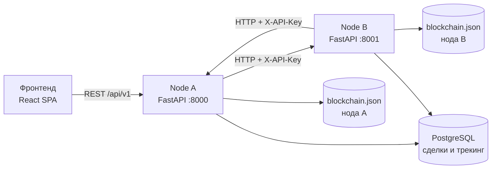

# CarLeon - платформа перевозки автомобилей из-за рубежа

## Сетевая демонстрация

Запуск двух нод и интерфейса:

```bash
docker compose up --build
```

Откройте `http://localhost:3001/network`, укажите API-ключ `change-me` и нажмите
«Создать и передать блок». Страница покажет реальные ответы Node A и Node B:
индекс/хэш созданного блока, транзакцию, подтверждение приёма, повторное получение
блока и отказ Node B на повреждённый блок. У нод отдельные постоянные тома.

Архитектура: [network_architecture.md](network_architecture.md). Контракт:
[network_protocol.md](network_protocol.md). Проверки:
[network_test_scenarios.md](network_test_scenarios.md).

Веб-платформа, которая соединяет поставщиков автомобилей из других стран
с заказчиками из России и обеспечивает прозрачное отслеживание сделки
на всех этапах - от выбора авто до передачи ключей

---

##  О проекте

Платформа решает две задачи:

1. **Для поставщика** - публикация предложений: из какой страны,
   какой автомобиль, по какой цене и на каких условиях возможна перевозка
2. **Для заказчика** - выбор автомобиля, оплата и отслеживание полного
   жизненного цикла сделки через систему статусов

---

## Цели и задачи

- Реализовать полный цикл сделки: от публикации авто до его получения.
- Обеспечить прозрачное отслеживание статусов на каждом этапе.


---

## Роли пользователей

| Роль         | Возможности                                                                 |
|--------------|------------------------------------------------------------------------------|
| **Поставщик** | Регистрация, публикация авто (страна, марка, модель, цена, фото), обновление статусов перевозки |
| **Заказчик**  | Просмотр каталога, оформление заказа, оплата, отслеживание статусов           |
| **Админ**     | Модерация объявлений, управление пользователями, разрешение спорных ситуаций |

---

## Жизненный цикл сделки (статусы)

```
Опубликовано → Заказ оформлен → Оплачен депозит → Выкуплен у продавца
→ В пути (страна отправки) → Таможня → В пути (РФ) → Доставлен в город
→ Готов к выдаче → Завершено
```

---

## Блокчейн

Собственная цепочка блоков на Python (см. `backend/app/blockchain/`):

- Блок — список записей о смене статусов + метка времени + SHA-256 хэш
- Каждый блок ссылается на хэш предыдущего (`previous_hash`)
- В блокчейне хранятся только статусы сделок и ссылки на файлы с хэшами;
  персональные данные и оплата остаются в PostgreSQL
- Цепочка каждой ноды хранится в отдельном JSON-файле и проверяется при загрузке
- Две ноды обмениваются блоками по HTTP-протоколу (см. сетевую демонстрацию выше)

---

## Тех. стек

- Frontend:  React 19 + TypeScript + Tailwind CSS 4 + Vite (SPA)
- Backend:   FastAPI + SQLAlchemy + PostgreSQL (сделки и трекинг)
- Блокчейн:  собственная реализация — Python, JSON-хранилище, SHA-256
- Сеть:      HTTP + JSON между нодами, общий `X-API-Key`
- Инфра:     Docker + docker-compose
---

## Архитектура



- Браузер работает только с Node A (nginx проксирует `/api` на неё)
- Node A и Node B — независимые экземпляры с собственными цепочками;
  блоки передаются вручную по HTTP, автоматической синхронизации нет
- В PostgreSQL — сделки и точки трекинга; в блокчейне — только история статусов

---

## Ветвление и правила работы с Git

Мы используем **Git Flow**:

- `main` - стабильная версия, только через Pull Request
- `develop` - основная ветка разработки
- `feature/<название>` - новая функциональность
- `fix/<название>` - исправления

**Правила:**
1. Одна задача = одна ветка
2. Осмысленные коммиты: `feat:`, `fix:`, `docs:`, `refactor:`
3. Перед пушем - проверка кода и тесты

---

## Структура репозитория

```
.
├── backend/            # FastAPI бэкенд (один образ = одна нода)
│   ├── app/
│   │   ├── api/        # API роуты (deals, tracking, blockchain, network)
│   │   ├── blockchain/ # Блоки, цепочка, хранилище JSON
│   │   ├── core/       # Основная конфигурация
│   │   ├── models/     # SQLAlchemy ORM модели
│   │   ├── schemas/    # Pydantic схемы
│   │   ├── services/   # Слой бизнес-логики
│   │   └── db/         # Управление сессиями БД
│   ├── tests/          # Тесты бэкенда (pytest)
│   ├── alembic/        # Миграции БД
│   ├── demo.py         # Демо сценариев блокчейна (одна нода)
│   ├── Dockerfile
│   └── requirements.txt
├── frontend/           # React фронтенд (Vite + Tailwind)
│   ├── src/
│   │   ├── components/ # Переиспользуемые UI компоненты
│   │   ├── pages/      # Страницы (включая /network — демо обмена блоками)
│   │   ├── hooks/      # Custom React hooks
│   │   ├── services/   # API вызовы
│   │   ├── utils/      # Утилитные функции
│   │   ├── context/    # React context провайдеры
│   │   └── types/      # TypeScript типы
│   ├── Dockerfile      # multi-stage: vite build → nginx + прокси на node-a
│   └── nginx.conf
├── docker-compose.yml  # node-a, node-b, frontend, postgres
├── network_architecture.md   # архитектура сетевого взаимодействия
├── network_protocol.md       # контракт API обмена блоками
└── README.md           # Документация проекта
```

---

## Команда

| Участник | Роль | Ответственность |
|----------|------|------------------|
| Максим | Аналитик | анализ требований, документация |
| Амир | Тех писатель | техническая документация |
| Артём | Тех писатель | техническая документация |
| Саша | Скрам/Тех писатель | координация, документация |

---

## Документация

- [Структура проекта](structure.md)
- [Архитектура](architecture.md)
- [Формат данных](data_format.md)
- [Аналитика](analytics.md)
- [Сетевая архитектура](network_architecture.md)
- [Сетевой протокол](network_protocol.md)
- [Сетевые тестовые сценарии](network_test_scenarios.md)

## Доступ к API

- Чтение каталога (`GET /deals`, `GET /blockchain` и т.п.) открыто — режим «только просмотр»
- Запись (`POST`/`DELETE`) и все эндпоинты `/network/*` требуют заголовок `X-API-Key`
- Тот же ключ используют ноды для межсерверных запросов (`PEERS_JSON` + `API_KEY`)
