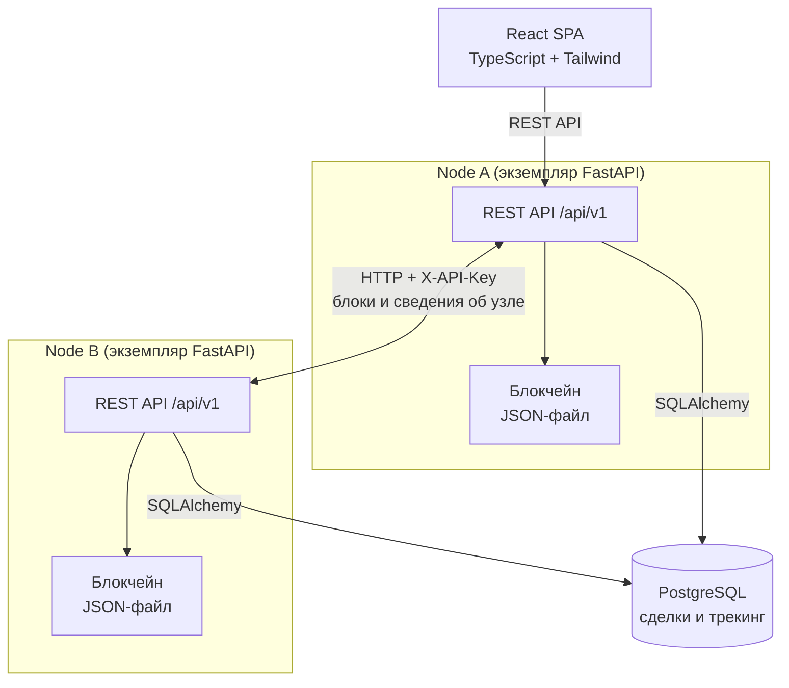
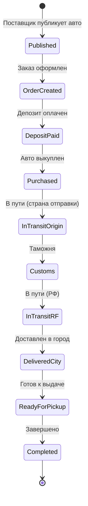
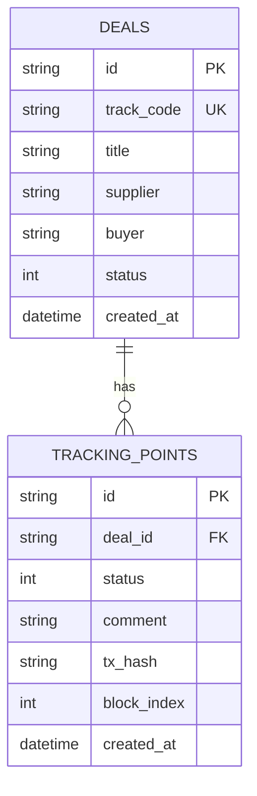
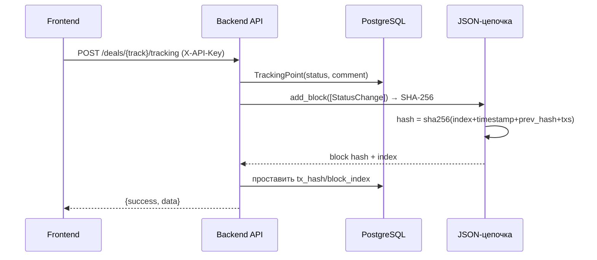

# Архитектура

## 1. Общая архитектура

**Описание:**

- Система запускает **несколько независимых нод** — один и тот же образ
  `backend/`, различаются только переменные окружения (`NODE_ID`,
  `NETWORK_ID`, `PEERS_JSON`, `CHAIN_JSON_PATH`). См.
  [network_architecture.md](network_architecture.md).
- У каждой ноды **собственное хранилище блокчейна** — отдельный JSON-файл
  (`CHAIN_JSON_PATH`), общее хранилище не используется.
- Браузер работает с одной нодой (в Compose — Node A через nginx-прокси);
  взаимодействие нод идёт сервер-сервер по HTTP.
- Бизнес-данные (сделки, точки трекинга) хранятся в общей PostgreSQL;
  в блокчейн попадает только история смен статусов и хэши прикреплённых файлов.
- Автоматической синхронизации цепочек нет: блок передаётся явно, а
  принимающая нода проверяет его до добавления в свою цепочку.

---

## 2. Жизненный цикл сделки

**Статусы:** 0–9 (`DealStatus` в `backend/app/blockchain/transaction.py`
и `backend/app/models/deal.py` — держать синхронно).

---

## 3. Структура базы данных

- `deals` — карточка сделки (статус продублирован в БД для быстрого доступа;
  источником истины по истории является блокчейн).
- `tracking_points` — событие смены статуса; `tx_hash` и `block_index`
  ссылаются на блок цепочки, в который запись попала.

---

## 4. Смена статуса сделки

При старте нода загружает цепочку из `CHAIN_JSON_PATH` и проверяет её
целостность (хэши блоков и записей); повреждённый файл отклоняется с ошибкой.

---

## 5. Обмен блоками между нодами

Кратко (подробно — в [network_protocol.md](network_protocol.md)):

1. Node A создаёт блок локально (как в п. 4) и сохраняет в свой файл.
2. `POST /network/peers/{peer}/blocks/{hash}/send` — Node A забирает блок
   из своей цепочки и отправляет JSON в `POST /network/blocks` на Node B.
3. Node B проверяет: индекс = следующему, `previous_hash` = хэш вершины,
   хэш блока и `content_hash` каждой записи пересчитываются и совпадают.
   Только после этого блок атомарно дописывается в файл Node B.
4. `GET /network/peers/{peer}/blocks/{hash}` — обратное чтение блока
   для проверки, что принята именно та запись.
5. Некорректный блок отклоняется `422 invalid_block` с перечнем ошибок;
   состояние принимающей цепочки не меняется.
