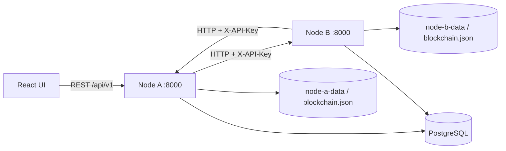

# Сетевая архитектура спринта 4

## Назначение

Система запускает два независимых экземпляра FastAPI. Каждый узел хранит собственную
цепочку в отдельном JSON-файле и не использует общее файловое хранилище блоков.
Узлы знают адреса друг друга из `PEERS_JSON`; динамического обнаружения и
автоматической синхронизации нет.

## Схема



В Docker Compose браузер открывает `http://localhost:3001`. Nginx направляет API
запросы в Node A, а Node A обращается к настроенным peers сервер-сервер. Внешний
порт Node B (`8001`) оставлен для проверки и прямых запросов при разработке.

## Идентичность и совместимость

- `NODE_ID` — идентификатор экземпляра.
- `NETWORK_ID` — имя совместимого учебного протокола.
- `PEERS_JSON` — статический список `id` и базового HTTP(S)-адреса известных узлов.
- `API_KEY` — общий секрет между узлами для запросов сведений и передачи блоков.
- Genesis-блок создаётся с фиксированными timestamp и записью, поэтому чистые узлы
  одной сети имеют одинаковый хэш генезиса.
- Перед пересылкой Node A сравнивает `network_id` и `genesis_hash` получателя.
- Получатель принимает только следующий блок с ожидаемыми индексом и ссылкой на
  свою вершину. Проверяются хэш блока и хэш каждой записи до изменения хранилища.

Разные истории после genesis не сливаются автоматически. Узел отвечает ошибкой
конфликта, если присланный блок не продолжает его текущую цепочку.

## Сценарий обмена

1. React запрашивает идентичность и вершину Node A.
2. Node A опрашивает статически настроенный Node B и показывает достижимость,
   совместимость, высоту и хэш вершины.
3. UI создаёт запись статуса на Node A через текущий API. Сервис формирует блок
   по общему формату и сохраняет его в хранилище Node A.
4. UI вызывает команду отправки по хэшу блока. Node A отправляет полный JSON-блок
   в Node B.
5. Node B проверяет блок, атомарно сохраняет цепочку и возвращает подтверждение с
   собственным `node_id`, индексом, хэшем и результатом проверки.
6. Node A отдельно запрашивает этот блок у Node B и UI сравнивает полученный хэш
   с отправленным.
7. UI запускает dev/demo-проверку некорректного блока. Node B возвращает
   `422 invalid_block`; доказательство содержит проверочную ошибку и фактические
   состояния получателя до и после запроса.

## Запуск двух узлов

```bash
docker compose up --build
```

Compose создаёт независимые тома `node-a-data` и `node-b-data`. Команда
`docker compose down` сохраняет эти данные. Для полного сброса учебной демонстрации
можно удалить её тома вручную; это удалит историю обеих нод.

В Compose установлен демонстрационный API-ключ `change-me`. Он предназначен только
для локального учебного стенда. В реальном окружении задайте секрет через
защищённые переменные окружения и включите HTTPS.

## Ограничения

- Нет автоматического поиска peers, широковещательной рассылки, консенсуса или
  разрешения конфликтующих веток.
- Блоки не содержат подписей автора; общий API-ключ подтверждает только право
  обращаться к учебному API.
- На каждый узел настраиваются известные адреса явно.
- Файлы внешних документов не передаются между узлами; в цепочке остаются путь и
  контрольная сумма, если они заданы.
